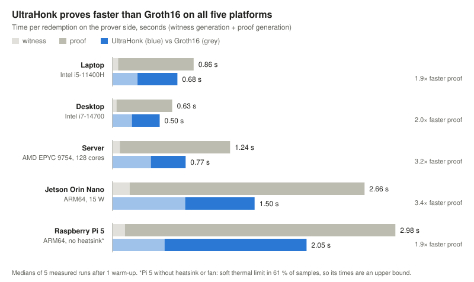
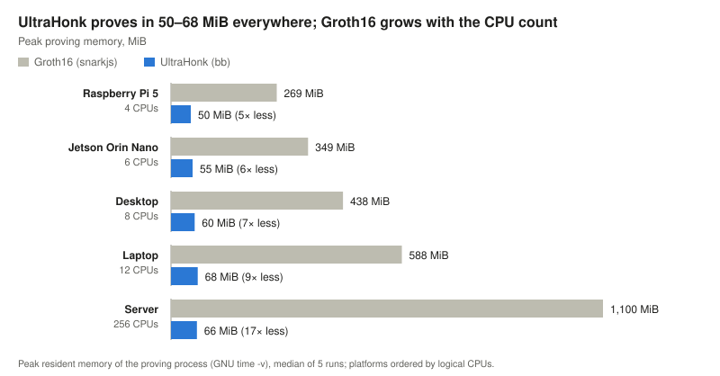

# zk-ePrescription

**Privacy-preserving e-prescription redemption with zero-knowledge proofs: one protocol, two independent proving stacks.**

A patient proves to a pharmacy that a prescription was signed by a registered
doctor for them, has not been altered, has not expired and has redemptions
left, without revealing their secret, the doctor's identity or the
prescription details; after verification the pharmacist sees only the
doctor-signed list of medicines to dispense. The same normative protocol
([`docs/protocol_specification.md`](docs/protocol_specification.md)) is
implemented twice:

| Backend | Circuit language | Proving system | Folder |
|---|---|---|---|
| A | Circom 2.2.3 | Groth16 (snarkjs 0.7.6), BN254 | `circom/` |
| B | Noir 1.0.0-beta.24 | UltraHonk (Barretenberg 5.0.0-nightly.20260522), BN254 | `noir/` |

Research artifact; not audited and not for clinical use.

> **Protocol v3.** The commitment contains the digest `D` of the prescription's
> medication list (code, name, dosage, quantity per medicine), and the proof
> outputs `D`. The patient's app sends the list; the pharmacy shows it only if
> it hashes to `D` (`scripts/pharmacy_verify.js`), so the pharmacist learns
> exactly what to dispense and a changed list is rejected. In v2 the medicine
> was a private input and the pharmacist learned nothing about it. The v2
> vectors are in `testdata/historical/v2/`.
>
> **Protocol v2.** The commitment includes the patient reference
> `I = H2(patient_secret)`, so the doctor's signature binds each prescription
> to the patient's secret. In v1 (commit `f257cad`) a holder of a valid
> issuance record could redeem it under any other secret and obtain fresh
> nullifiers, so the refill limit was not enforced; the new attack vectors
> NT-021 and NT-022 cover this. The benchmark numbers below were measured on
> v1 and are being re-measured on the current version.

---

## Quick start

Requirements: Docker. Network access is needed only for `docker build`, which
also downloads and caches Barretenberg's CRS; the commands below run offline.

```bash
docker build -t zkep .
docker run --rm zkep demo     # one redemption end to end, explained step by step
docker run --rm zkep test     # full regression with a summary table
docker run --rm zkep kat      # cross-backend equality of every protocol value
```

Each command prints one line per check; full tool output is written to
`results/logs/` inside the container (mount it with `-v "$PWD/results:/workspace/results"`
to keep it). `docker run --rm -it zkep bash` opens a shell with every tool.

## One command: clone, test and benchmark on your machine

```bash
git clone https://github.com/SPriTLab-CSE-IITJ/zk-ePrescription.git
cd zk-ePrescription
bash bench/run_device.sh        # sudo bash bench/run_device.sh if your user cannot run docker
```

`bench/run_device.sh` does everything in one go: records the machine, builds
the image, runs the full regression (E2), runs the benchmark (E3), prints a
summary, checks that your compiled circuits are identical to the published
ones, and packs the result into `results/<label>_bench.tgz`. It works on Linux
(x86-64 and ARM64, including Jetson and Raspberry Pi 5 with a 64-bit OS),
Windows through WSL2, and macOS with Docker Desktop. Allow about 12 GB of disk
and 20–40 minutes on a PC (1–3 hours on a small board, mostly the first build).

It changes nothing on your machine unless you ask: on a fresh Debian/Ubuntu
board with nothing installed, use
`sudo bash bench/run_device.sh --install-docker --add-swap --max-performance`.
Options are described in [`bench/README.md`](bench/README.md).

## Benchmark results

*Protocol v1 (commit `f257cad`); re-measurement for v2 pending.* Both backends
were measured with this procedure on five platforms. Every run passed all 46
validation checks, and all five built byte-identical circuits.





| Median | Laptop | Desktop | Server | Jetson Orin Nano | Raspberry Pi 5* |
|---|---:|---:|---:|---:|---:|
| Groth16 prove / verify | 0.797 / 0.354 s | 0.588 / 0.224 s | 1.163 / 0.690 s | 2.479 / 0.854 s | 2.853 / 0.633 s |
| UltraHonk prove / verify | 0.421 / 0.009 s | 0.293 / 0.007 s | 0.367 / 0.017 s | 0.733 / 0.023 s | 1.498 / 0.028 s |
| Proof size, Groth16 / UltraHonk | 0.8 KB / 14.3 KB | same | same | same | same |

\*The Pi 5 had no heatsink or fan and reached 86.5 °C; its firmware reported the
soft temperature limit in 61 % of samples, so its times are an upper bound (an
earlier run, throttled in 93 % of samples, was only 5–8 % slower at proving). Full tables, run conditions and setup costs:
[`docs/BENCHMARK_RESULTS.md`](docs/BENCHMARK_RESULTS.md). The raw result
archives of all runs, with a script that recomputes every number from the
individual runs, are in the release
[bench-evidence-2026-10-30](https://github.com/SPriTLab-CSE-IITJ/zk-ePrescription/releases/tag/bench-evidence-2026-10-30).

---

## Major claims

| Claim | Statement | Evidence |
|---|---|---|
| **C1** Equivalence | Both backends compute identical protocol values (Poseidon2 permutation and sponge, C, I, N, registry leaves, nodes and root) for identical inputs. | E1: 100/100 equal |
| **C2** Soundness checks | Valid redemptions verify in both backends; every attack vector (24, including redemption under another patient secret and a reused v1 signature) is rejected by a circuit constraint or, for an out-of-range slot in Noir, by the u64 input type, the patient reference `I` is never public, tampered public inputs do not verify, and a redemption service fed with either backend's outputs accepts each refill slot once and rejects replays. | E2: summary table |
| **C3** Performance | Per-redemption cost of both stacks on three x86-64 machines (laptop, desktop, 128-core server), as reported in [`docs/BENCHMARK_RESULTS.md`](docs/BENCHMARK_RESULTS.md). | E3 |
| **C4** ARM64 boards | The same protocol runs and is benchmarked on NVIDIA Jetson Orin Nano and Raspberry Pi 5. | E4 |

## Experiments

### E1: cross-backend equality (claim C1)

Under a minute of compute after the image build.

```bash
docker run --rm zkep kat
```

Expected end of output:

```
      input set 'canonical': 16 protocol values ......... 16/16 equal  PASS
      ...
      registry generator: leaves, paths, root ........... 4/4 equal  PASS
      TOTAL (JS reference = Circom = Noir) .............. 100/100 equal  PASS
```

Six input sets (canonical, three other doctors, edge and zero values) are
evaluated by an independent JavaScript reference, the Circom witness and Noir
execution; the raw permutation is also compared with independent reference
vectors (`testdata/kat/poseidon2_permutation_reference.json`).

### E2: regression (claim C2)

A few compute minutes; most of it is the one-time local Groth16 ceremony.

```bash
docker run --rm zkep test
```

The run prints five sections (Circom/Groth16, Noir/UltraHonk, the attack table,
the nullifier store, cross-backend equality) and ends with:

```
SUMMARY                                   Circom / Groth16    Noir / UltraHonk
  valid redemptions (outputs = fixture)    5/5                 5/5
  proofs generated and verified            5/5                 5/5
  attack vectors rejected                  25/25               25/25
  tampered public inputs rejected          5/5                 25/25
  Schnorr verifier vectors                 8/8                 8/8
  I and secret not public (redemptions)    5/5                 5/5
  pharmacy view (signed list only)         8/8                 8/8
  circuit size (native units)              12648 R1CS          16687 ACIR opcodes
  library tests (Noir)                     7/7
  nullifier store (replays rejected)       6/6 steps as expected
  cross-backend KAT                        100/100 equal

RESULT: ALL REGRESSION TESTS PASSED
```

The attack table names, for every vector, what the attacker changed and which
check rejected it in each backend (signature, registry, expiry,
slot < threshold, s < l bound, point on curve, binary direction). The
pharmacist's view of the canonical prescription is written to
`results/pharmacy_view_circom.txt` and `results/pharmacy_view_noir.txt`.
[`docs/TEST_RESULTS.md`](docs/TEST_RESULTS.md) explains each line.

### E3: benchmark (claim C3)

About 10 compute minutes; runs on the host, not inside the container.
`bash bench/run_device.sh` does all of this in one command; the individual steps are:

```bash
docker build -t zkep .
bash bench/run_benchmark.sh my-laptop --plan   # preflight and dry run, measures nothing
bash bench/run_benchmark.sh my-laptop          # 1 warm-up + 5 measured runs per stage
node bench/print_summary.js results/bench/my-laptop_<UTC>
```

Compare the printed medians with the table in
[`docs/BENCHMARK_RESULTS.md`](docs/BENCHMARK_RESULTS.md). Absolute times depend
on the hardware; circuit sizes, proof sizes and verification-key sizes must
match exactly. See [`bench/README.md`](bench/README.md).

### E4: ARM64 boards (claim C4)

The same command on the board (64-bit OS):

```bash
sudo bash bench/run_device.sh --install-docker --add-swap --max-performance
```

`--max-performance` locks the clocks (`jetson_clocks` on Jetson, the CPU
governor elsewhere) and restores them at the end. Use active cooling on a
Raspberry Pi 5: without it the board throttles, as in the published run.

---

## Protocol in brief

```text
D  = H7(medication list)                                                medication-list digest, public
I  = H2(patient_secret)                                                 patient reference, private
C  = H1(prescription_id, doctor_id, D, expiry, threshold, I)             commitment, public; signed
N  = H3(patient_secret, C, slot_index)                                  nullifier, public
L  = H4(doctor_id, PKx, PKy),  M = H5(left, right)                      doctor registry (Merkle)
c  = Hraw(Rx, Ry, PKx, PKy, C);  s*B8 = R + 8*c*PK,  s < l             Schnorr on Baby Jubjub
current_date <= expiry,  slot_index < threshold                         policy (date set by the verifier)
```

Poseidon2 over the BN254 scalar field (t = 4, rate 3, x^5, 8 + 56 + 8 rounds);
`H1`–`H5` prepend domain tags 1–5 (tag 6, the v1 issuance binding, is retired);
`H7`, computed off-circuit by the doctor's software and the pharmacy, hashes the
canonical encoding of the medication list.
Public inputs: registry root and `current_date`; public outputs: `C`, `N` and `D`.
Everything else, including `I`, is private. The pharmacy sees the medication
list itself, checked against `D`. Because the doctor signs `C` and
`C` contains `I`, only the holder of `patient_secret` can redeem, and each
refill slot has exactly one nullifier.

## Scope and non-claims

- National or health-ID authentication happens at enrollment, outside the
  circuit; the redemption proof is not a fresh identity check. Binding a
  prescription to `patient_secret` binds it to a secret: that the secret
  belongs to the authenticated patient is the enrollment system's job.
- The circuit only derives `N`; single-use redemption needs one redemption
  service, shared by all pharmacies, that checks and stores accepted
  nullifiers atomically. The guarantee is one redemption per slot, at most
  `threshold` per prescription; every redemption dispenses the whole
  medication list. Neither that service nor patient notification is
  implemented here (the service is simulated in memory).
- A redemption QR is a transferable bearer token for one slot on one date: a
  relative can collect the medicine with it, and a stolen or relayed QR is not
  prevented from being used first (only detectable through notification).
- The pharmacy must take the registry root from an authenticated source, the
  date from its own clock and the verification key from its own software; the
  circuits cannot check this ([`docs/protocol_specification.md`](docs/protocol_specification.md), Sections 26-27).
- The pharmacist sees the medication list, which can hint at a condition;
  that is the minimum needed to dispense. The codes in the test list are
  illustrative placeholders, not checked against SNOMED CT.
- `C` and `N` are public, so redemptions of one prescription are linkable. No
  anonymity, unlinkability or collusion-resistance claim is made; see
  [`docs/threat_model.md`](docs/threat_model.md). There is no formal security proof.
- The Groth16 setup in the tests and the benchmark is a local single-contributor
  development ceremony, not a production trusted setup. All keys are test keys.
- Circuit sizes are backend-native units (R1CS constraints, ACIR opcodes,
  Barretenberg gates) and are not comparable with each other.

## Repository map

```text
circom/circuits/     redemption.circom (entry), lib_modules, registry, schnorr_bjj,
                     poseidon2(+constants), kat/ harnesses
circom/inputs/       TV-001..005 and NT-001..025 vectors, Schnorr unit vectors
circom/scripts/      build_canonical_fixture.js (generates every vector), lib/ JS reference
noir/common/         Poseidon2 sponge and H1-H5 (the only Poseidon2 source in Noir)
noir/redemption/     redemption circuit (entry), tests/positive, tests/negative
noir/kat/, noir/registry_generator/
scripts/             run.sh (container entry point), test.sh, demo.sh, suites, kat/,
                     pharmacy_verify.js (pharmacist's view), lib/medication_list.js
bench/               run_device.sh (one-command run), benchmark harness v1.4.2
docs/                specification, threat model, architecture, toolchain, results
testdata/kat/        canonical fixture, medication list and KAT reference vectors
testdata/historical/ pre-alignment, protocol-v1 and protocol-v2 vectors, kept for provenance only
```

[`docs/architecture.md`](docs/architecture.md) describes every file and how the
vectors are generated.

## License

MIT; see [`LICENSE`](LICENSE). Dependencies keep their own licences: circomlib
(whose templates the Circom circuits include), circomlibjs and snarkjs are
GPL-3.0; Noir is MIT or Apache-2.0 and Barretenberg is Apache-2.0.
