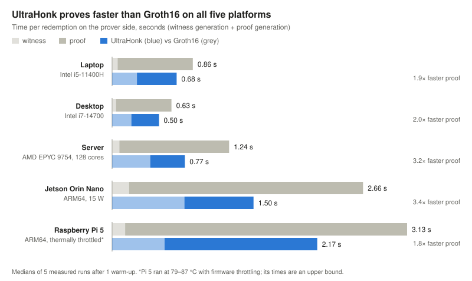
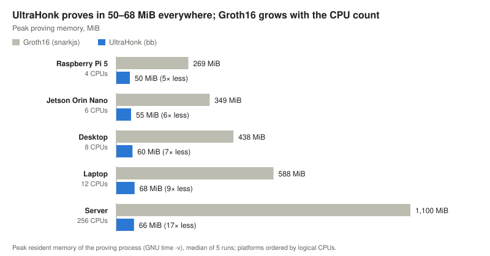

# Benchmark Results

Both backends were measured on the canonical fixture TV-001 on five machines:
two x86-64 PCs, a 128-core server and two ARM64 boards. Every run passed
all 46 validation checks (every proof verified, public outputs equal to the
fixture, circuit sizes as expected, source tree unchanged), and all five
produced the same compiled circuits: R1CS `26cbeef7…0b56d1b`, witness WASM
`4ddf1b05…8119821`, ACIR bytecode and UltraHonk verification key
`4e8a56ad…e244c2d`. Groth16 keys differ because each run performs its own local
ceremony. To benchmark your own machine: `bash bench/run_device.sh`
(see [`bench/README.md`](../bench/README.md)).

## Platforms

| | Laptop (P1) | Desktop (P2) | Jetson Orin Nano (P3) | Server (P4) | Raspberry Pi 5 (P5) |
|---|---|---|---|---|---|
| CPU | Intel Core i5-11400H @ 2.70 GHz | Intel Core i7-14700 | 6× Arm Cortex-A78AE @ 1.51 GHz (locked) | AMD EPYC 9754, 128 cores | 4× Arm Cortex-A76 @ 2.4 GHz |
| Architecture | x86-64 | x86-64 | ARM64 | x86-64 | ARM64 |
| Logical CPUs visible | 12 | 8 (WSL2 limit) | 6 | 256 | 4 |
| RAM (host / visible) | 15.73 / 7.62 GiB | 15.72 / 11.68 GiB | 7.31 / 7.31 GiB | 125 / 125 GiB | 7.87 / 7.87 GiB |
| OS | Ubuntu 24.04.4 on WSL2, Windows 11 | Ubuntu 26.04 on WSL2, Windows 11 Pro | Ubuntu 24.04.4, Jetson Linux R39.2 | Ubuntu 24.04.1, native | Raspberry Pi OS (Debian 13), 16 KB pages |
| Power / clocks | default | default | 15 W mode, `jetson_clocks` | default (schedutil, boost), shared server | governor `performance`; thermally throttled |
| Docker | 29.1.3 | 29.8.0 | 29.1.3 | 29.8.1 | 29.7.2 |
| Harness | v1.3 | v1.4 | v1.4 | v1.4 | v1.4 |
| Source | pre-restructure tree (same circuits) | `f257cad` (ZIP) | `f257cad` (git) | `f257cad` (git) | `f257cad` (git) |
| Result directory | `laptop-x86_64-wsl2_20261004T083403Z` | `pc2-Intel-R-Core-TM-i7-14700-wsl2_20261028T100755Z` | `jetson-orin-nano-aarch64-docker_20261028T114754Z` | `server-amd-epyc-9754-x86_64-docker_20261028T124706Z` | `raspberry-pi-5-aarch64-docker_20261029T132237Z` |

## Per-redemption cost

Medians of 5 measured runs after 1 warm-up (compile: 3 after 1). Sizes are
12,291 R1CS constraints (Circom) and 16,681 ACIR opcodes / 22,182 Barretenberg
gates (Noir) on every platform.

| Metric | P1 | P2 | P3 | P4 | P5 |
|---|---:|---:|---:|---:|---:|
| **Groth16** compile | 0.404 s | 0.284 s | 1.106 s | 0.601 s | 0.867 s |
| Groth16 witness | 0.058 s | 0.041 s | 0.180 s | 0.077 s | 0.138 s |
| Groth16 prove | 0.797 s | 0.588 s | 2.479 s | 1.163 s | 2.988 s |
| Groth16 verify | 0.354 s | 0.224 s | 0.854 s | 0.690 s | 0.652 s |
| Groth16 peak RSS, prove | 588.10 MiB | 438.21 MiB | 349.06 MiB | 1,100.43 MiB | 269.33 MiB |
| Groth16 peak RSS, verify | 161.72 MiB | 132.13 MiB | 121.45 MiB | 568.21 MiB | 105.80 MiB |
| Groth16 proof / VK | 802 / 3,480 B | 801 / 3,476 B | 805 / 3,463 B | 806 / 3,480 B | 804 / 3,476 B |
| **UltraHonk** compile | 0.646 s | 0.416 s | 2.006 s | 0.811 s | 1.558 s |
| UltraHonk execute (witness) | 0.263 s | 0.204 s | 0.766 s | 0.404 s | 0.556 s |
| UltraHonk prove | 0.421 s | 0.293 s | 0.733 s | 0.367 s | 1.618 s |
| UltraHonk verify | 0.009 s | 0.007 s | 0.023 s | 0.017 s | 0.033 s |
| UltraHonk peak RSS, prove | 67.98 MiB | 60.31 MiB | 54.93 MiB | 66.11 MiB | 50.38 MiB |
| UltraHonk peak RSS, verify | 9.21 MiB | 8.50 MiB | 7.00 MiB | 6.09 MiB | 7.19 MiB |
| UltraHonk proof / VK | 14,656 / 3,680 B | 14,656 / 3,680 B | 14,656 / 3,680 B | 14,656 / 3,680 B | 14,656 / 3,680 B |
| Proving range, Groth16 | 0.775–0.970 s | 0.574–0.635 s | 2.462–2.500 s | 1.124–1.174 s | 2.954–3.039 s |
| Proving range, UltraHonk | 0.417–0.469 s | 0.282–0.312 s | 0.723–0.743 s | 0.353–0.385 s | 1.575–1.646 s |

- **Sizes are backend-native units.** R1CS constraints, ACIR opcodes and
  Barretenberg gates measure different things and are not comparable.
- **Median is the primary statistic.** Peak RSS is the median over the
  measured runs. No value is estimated.
- Circom witness = `generate_witness.js` (WASM); Noir witness = `nargo execute`.
- Groth16 proof and VK are JSON text, so their size varies by a few bytes with
  the encoding of the numbers; the UltraHonk files are binary and fixed.

## One-time setup

| Stage | P1 | P2 | P3 | P4 | P5 |
|---|---:|---:|---:|---:|---:|
| Powers of Tau new | 1.113 s | 0.738 s | 2.797 s | 1.553 s | 2.359 s |
| Powers of Tau contribution | 10.292 s | 6.441 s | 38.732 s | 3.595 s | 66.992 s |
| Powers of Tau phase-2 preparation | 187.107 s | 132.061 s | 840.331 s | 33.184 s | 1,230.449 s |
| Groth16 setup | 7.950 s | 4.409 s | 21.877 s | 8.524 s | 21.359 s |
| zkey contribution | 1.482 s | 0.941 s | 5.353 s | 1.010 s | 7.204 s |
| Groth16 VK export | 0.361 s | 0.232 s | 0.903 s | 0.686 s | 0.695 s |
| UltraHonk VK generation | 0.125 s | 0.105 s | 0.292 s | 0.159 s | 0.457 s |

Each stage is measured once and is not per-redemption latency. The Groth16
setup is a local single-contributor development ceremony, not a production
trusted setup; UltraHonk uses Barretenberg's universal CRS.

## Observations

- UltraHonk proves faster than Groth16 on every platform: 1.9× (P1), 2.0× (P2),
  3.4× (P3), 3.2× (P4), 1.8× (P5, thermally throttled).
- UltraHonk uses 5–17× less peak proving memory. The Groth16 figure is the
  whole snarkjs Node.js process and grows with the CPU count (269 MiB with 4
  CPUs, 1,100 MiB with 256), most likely because snarkjs starts a worker per CPU.
- Groth16 has a much smaller proof: about 0.8 KB against 14.3 KB.
- UltraHonk verifies in 7–33 ms against 224–854 ms for snarkjs, whose figure
  includes Node.js start-up.
- On the ARM64 boards a redemption takes 1.5 s (P3) and 2.2 s (P5) on the
  prover side with UltraHonk, using about 50 MiB. On P3 Groth16 proving is 3.1×
  slower than on P1 but UltraHonk only 1.7× slower.
- The 128-core server gives no single-proof speed-up: Groth16 proves slower than
  on P1, UltraHonk lands between P1 and P2. Its cores help the one-time setup
  (phase-2 preparation 33 s against 187 s on P1).

## Run conditions

- P1 used harness v1.3 before the restructure, when the entry circuits were
  `circom/circuits/08_eprescription_main.circom` and `noir/phase4_orchestrator`;
  the compiled circuits are byte-identical to `redemption.circom` and
  `noir/redemption`.
- P2 ran from a ZIP of `f257cad`; its source manifest
  (`host_env/source_manifest_zip_f257cad.sha256`, `1cf2c52a…`) equals the merged
  tree. It was started with `sudo` because harness v1.4 left root-owned output
  on Linux filesystems; v1.4.1 fixes this without changing a measured command.
- P3: CPU at 1,510 MHz in every `tegrastats` sample, maximum junction temperature
  54.9 °C, board power at most 8.1 W, swap at most 15 MB. The faster MAXN SUPER
  power mode was not used.
- P4 is a shared server, so CPU settings were left as found. Load before the run
  was 0.3–0.6; the peak of 24 during it came from the benchmark's own processes.
- P5 reached 79–87 °C (median 83.7 °C); in 642 of 689 two-second samples the
  firmware reported its soft temperature limit or a capped/throttled clock
  (`vcgencmd get_throttled`), so its times are an upper bound. The 16 KB-page
  kernel caused no failures and the regression passed. A re-run with active
  cooling is planned.
- Images: P1 `sha256:af38ddc2…` (frozen image plus GNU `time`), P2
  `sha256:a1d888f5…`, P3 `sha256:8ed9ddd6…`, P4 `sha256:7866ec94…`, P5 `sha256:6ef96d6f…`.

## Toolchain

Circom 2.2.3, snarkjs 0.7.6, Nargo 1.0.0-beta.24, Barretenberg
5.0.0-nightly.20260522, Node v18.20.8, on every platform. Raw measurements,
metadata, validation output and artifact hashes of all five runs are published
in the release
[bench-evidence-2026-10-30](https://github.com/SPriTLab-CSE-IITJ/zk-ePrescription/releases/tag/bench-evidence-2026-10-30)
with `verify_benchmarks.py`, which recomputes every median from the raw runs.
